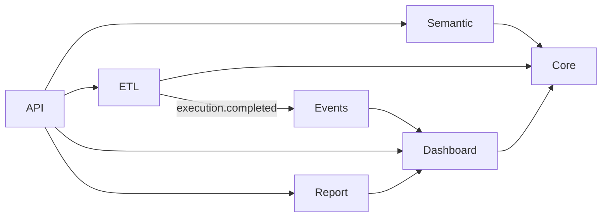

# PyBI Architecture Overview

## Principles

- `pybi` is the canonical application package. New implementation code belongs there.
- Modules have one owner: semantic definitions and engines live in `pybi.semantic`,
  ETL execution in `pybi.etl`, dashboard filter state in `pybi.dashboard`, and
  report persistence/rendering in `pybi.report`.
- `pybi.core` contains shared infrastructure such as storage, events, filtering
  primitives, interfaces, and exceptions; domain behavior should not be added there.
- The legacy `pybi.model`, `pybi.models`, and `backend` paths are compatibility
  shims. Use canonical `pybi.*` modules in new code.

## Current Package Layout

```text
pybi/
├── config.py                 # Pydantic Settings and environment configuration
├── api/                      # FastAPI app, DTOs, versioned routes
├── auth/                     # JWT and RBAC
├── core/                     # Shared infrastructure and compatibility exports
│   ├── events.py             # Synchronous internal event bus
│   ├── filtering.py          # Shared SQL filter clause construction
│   └── storage.py            # Project storage interface and file implementation
├── semantic/                 # Semantic schemas, DAX, relationships, RLS, model sync
│   ├── schema.py             # Persisted semantic model and YAML serialization
│   ├── model_view.py         # Relationship-editor API schema
│   ├── models.py             # Semantic query request/response adapters
│   ├── dax_translator.py     # DAX-to-DuckDB translation registry
│   ├── dax_api.py            # DAX validation and completion API engine
│   ├── rls.py                # Row-level security
│   └── engine.py             # Semantic SQL resolution and execution
├── etl/                      # Connectors, nodes, compiler, executor, scheduler
├── dashboard/                # Widget binding and the canonical FilterContext
├── report/                   # Report models, query construction, visuals, storage
├── export/                   # Static export, snapshots, templates
├── mcp_integration/          # MCP server and tool implementations
└── ui/, frontend/, publish/   # NiceGUI pages, frontend components, publishing

backend/
├── __init__.py               # Emits a DeprecationWarning
└── main.py                   # Deprecated application entry point
```

The old `pybi.model` and `pybi.models` modules re-export canonical semantic and
report definitions for existing callers. The `backend` subpackages have been
removed; migrate imports such as `backend.api.*` to their corresponding `pybi.*`
paths. `python -m backend.main` remains as a deprecated launch command.

Several semantic schemas intentionally remain distinct because they represent
different contracts: the persisted semantic model (`semantic.schema`), the
relationship-editor payload (`semantic.model_view`), the semantic-query adapter
(`semantic.models`), and the in-memory registration schema (`semantic.runtime_schema`).
They share one package but are not interchangeable wire formats.

## Runtime Configuration

`pybi.config.Settings` reads environment variables and `.env`. Existing settings
include `DATA_DIR`, `EXPORTS_DIR`, `DUCKDB_THREADS`, `DUCKDB_MAX_MEMORY`, and
`PYBI_JWT_SECRET`. A production deployment must provide a JWT secret of at least
32 characters. `DATABASE_URL` and `REDIS_URL` are accepted for deployment
configuration but are not currently used to select storage or cache backends.

## Module Communication and Filters



ETL publishes project-scoped completion events. The default dashboard binder
subscribes to successful executions and registers or refreshes output tables,
without making the ETL engine import dashboard code. Dashboard `FilterContext`
owns interactive/cross-filter state; report visuals and query building consume
that context. Shared SQL clause formatting lives in `pybi.core.filtering` to
avoid a semantic-to-dashboard import cycle.
